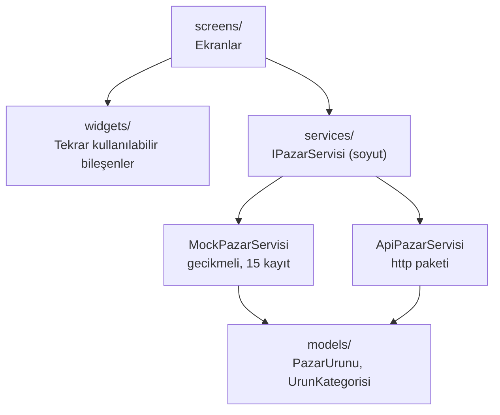

<div align="center">

# 🥬 TazeTezgah

**Semt Pazarı ve Yerel Üretici Tezgahı Mobil Uygulaması**

Yerel üreticilerin taze ürünlerini sergilediği, kullanıcıların pazara gitmeden önce ürün arayıp **"Tezgahta Ayırtma"** yapabildiği Flutter uygulaması.


[Proje Hakkında](#-proje-hakkında) •
[Özellikler](#-özellikler) •
[Kurulum](#-kurulum-ve-çalıştırma) •
[Dosya Yapısı](#-proje-dosya-yapısı) •
[Testler](#-testler) •
[Ekip](#-ekip-ve-görev-dağılımı)

</div>

---

## 📑 İçindekiler

1. [Proje Hakkında](#-proje-hakkında)
2. [Projenin Amacı](#-projenin-amacı)
3. [Özellikler](#-özellikler)
4. [Ekran Görüntüleri](#-ekran-görüntüleri)
5. [Kullanılan Teknolojiler](#-kullanılan-teknolojiler)
6. [Mimari](#-mimari)
7. [Proje Dosya Yapısı](#-proje-dosya-yapısı)
8. [Kurulum ve Çalıştırma](#-kurulum-ve-çalıştırma)
9. [Kod Dokümantasyonu](#-kod-dokümantasyonu)
10. [Testler](#-testler)
11. [Git İş Akışı ve Commit Kuralları](#-git-iş-akışı-ve-commit-kuralları)
12. [Ekip ve Görev Dağılımı](#-ekip-ve-görev-dağılımı)
13. [Teknik Şartların Karşılanması](#-teknik-şartların-karşılanması)
14. [Yol Haritası](#-yol-haritası)
15. [Lisans](#-lisans)

---

## 📖 Proje Hakkında

**TazeTezgah**, semt pazarı esnafı ve yerel üreticilerin günlük taze ürünlerini (sebze, meyve, şarküteri, zeytinyağı, köy ürünleri vb.) birim fiyatları, tezgah numaraları ve bulundukları pazar bilgileriyle sergilediği bir mobil uygulamadır.

Kullanıcılar:

- Ürünleri ada veya semt pazarına göre arayabilir, kategoriye göre filtreleyebilir,
- Ürünün yetiştirildiği bölge, hasat tarihi ve saklama önerileri gibi detayları inceleyebilir,
- Pazara gitmeden önce istedikleri ürünü kilo/adet seçerek **tezgahta ayırtabilir**,
- Ayırttıkları ürünleri, toplam tahmini tutarı ve tezgah numaralarını tek ekranda görebilir.

Üreticiler ise form ekranı üzerinden tezgaha yeni ürün ekleyebilir; müşteriler aynı ekrandan özel toplu sipariş talebi oluşturabilir.

> Bu proje, **Mobil Programlama** dersi kapsamında **Grup 7** tarafından geliştirilmektedir.

---

## 🎯 Projenin Amacı

| Hedef | Açıklama |
|---|---|
| **Yerel üreticiyi görünür kılmak** | Küçük üreticilerin ürünlerini dijital ortamda sergileyebilmesi |
| **Pazar deneyimini planlamak** | Kullanıcının pazara gitmeden hangi tezgahta ne bulacağını bilmesi |
| **Temiz kod pratiği** | Kodun tek dosyaya yığılmadan katmanlı mimari (`models`, `services`, `screens`, `widgets`) ile yazılması |
| **Ekip çalışması** | Her üyenin kendi branch'inde, anlamlı commit geçmişiyle çalışması |

---

## ✨ Özellikler

### 1. Pazar Tezgahı ve Ürün Listesi
- `GridView.builder` ile ürün kartları (görsel, ad, kg/adet fiyatı, üretici, pazar günü/semti)
- **Organik / Tükendi / Taze Geldi** rozetleri
- Ürün adına veya semt pazarına göre **anlık arama**
- `ChoiceChip` ile kategori filtreleri: *Tümü, Sebze, Meyve, Kahvaltılık/Süt, Zeytin/Yağ, Kuruyemiş*
- `RefreshIndicator` ile aşağı çekip yenileme

### 2. Ürün ve Üretici Detayı
- Listeden `Hero` animasyonuyla büyük görsele geçiş
- Yetiştirildiği bölge, hasat tarihi, tezgah numarası, pazar açılış saatleri, saklama önerileri
- **"Tezgahta Ayırt"** → `ModalBottomSheet` ile kilo/adet seçimi ve not bırakma

### 3. Yeni Ürün / Sipariş Talebi Formu
- Ürün adı, kategori, birim fiyat, stok miktarı, pazar yeri/tezgah no, açıklama
- `Form` + `GlobalKey<FormState>` ile validasyon:
  - Boş alan kontrolü
  - Fiyat ve miktarda pozitif sayı kontrolü
  - Minimum karakter kontrolü

### 4. Ayırttıklarım ve Pazar Sepetim
- Ayırtılan ürünler, tezgah numaraları ve **toplam tahmini tutar**
- Listeden ürün çıkarma
- `NavigationBar` ile ekranlar arası geçiş

### Genel
- 4 durumlu veri yönetimi: **Yükleniyor → Hata (Tekrar Dene) → Boş → Başarılı**
- Uygulama içinden değiştirilebilen **Material 3 Açık/Koyu tema**

---

## 📱 Ekran Görüntüleri

> Ekran görüntüleri `docs/screenshots/` klasörüne eklenecektir.

| Ürün Listesi | Ürün Detayı | Tezgahta Ayırt |
|:---:|:---:|:---:|
|  |  |  |

| Ürün Ekleme Formu | Pazar Sepetim | Koyu Tema |
|:---:|:---:|:---:|
|  |  |  |

---

## 🛠 Kullanılan Teknolojiler

| Teknoloji | Kullanım Amacı |
|---|---|
| **Flutter 3.x / Dart 3.x** | Çapraz platform mobil uygulama |
| **Material 3** | Arayüz bileşenleri ve açık/koyu tema |
| **http** | REST API'den veri çekme (gerçek API kullanılırsa) |
| **flutter_test** | Birim ve widget testleri |
| **flutter_lints** | Kod standartları ve statik analiz |

---

## 🏗 Mimari

Uygulama, ders kapsamında işlenen **katmanlı mimari** ile yazılmıştır. Ekranlar veriyi doğrudan tanımlamaz; soyut `IPazarServisi` arayüzü üzerinden alır. Böylece sahte (mock) servis ile gerçek API servisi, ekranlarda hiçbir değişiklik yapmadan birbirinin yerine kullanılabilir.



**Veri akışı:** Ekran → `IPazarServisi.urunleriGetir()` → `Future<List<PazarUrunu>>` → JSON `fromJson` ile modele dönüşür → ekran durumuna göre (yükleniyor / hata / boş / başarılı) çizilir.

---

## 📂 Proje Dosya Yapısı

```
tazetezgah/
├── lib/
│   ├── main.dart                       # Uygulama giriş noktası, tema ve kök widget
│   │
│   ├── models/                         # Veri modelleri
│   │   ├── pazar_urunu.dart            # PazarUrunu: fromJson, toJson, copyWith
│   │   ├── urun_kategorisi.dart        # UrunKategorisi enum (Sebze, Meyve, ...)
│   │   ├── urun_durumu.dart            # Organik / Tükendi / Taze Geldi rozet enum'u
│   │   └── ayirtma.dart                # Ayırtma kaydı (ürün, miktar, not)
│   │
│   ├── services/                       # Veri ve iş mantığı katmanı
│   │   ├── i_pazar_servisi.dart        # Soyut servis arayüzü
│   │   ├── mock_pazar_servisi.dart     # Gecikmeli sahte servis (15 kayıt)
│   │   ├── sepet_servisi.dart          # Ayırtılan ürünlerin yönetimi
│   │   └── tema_servisi.dart           # Açık/Koyu tema durumu (ThemeMode)
│   │
│   ├── screens/                        # Uygulama ekranları
│   │   ├── ana_iskelet.dart            # NavigationBar içeren ana iskelet
│   │   ├── tezgah_listesi_ekrani.dart  # Liste, arama, filtre, yenileme
│   │   ├── urun_detay_ekrani.dart      # Hero görsel ve üretici detayı
│   │   ├── urun_form_ekrani.dart       # Yeni ürün / sipariş talebi formu
│   │   └── sepet_ekrani.dart           # Ayırttıklarım ve Pazar Sepetim
│   │
│   └── widgets/                        # Tekrar kullanılabilir bileşenler
│       ├── urun_karti.dart             # Ürün kartı
│       ├── tazelik_rozeti.dart         # Organik / Tükendi / Taze Geldi rozeti
│       ├── fiyat_etiketi.dart          # "₺45 / kg" fiyat etiketi
│       ├── kategori_filtresi.dart      # Yatay ChoiceChip listesi
│       ├── ayirt_alt_penceresi.dart    # ModalBottomSheet içeriği
│       └── durum_gorunumleri.dart      # Yükleniyor / Hata / Boş görünümleri
│
├── test/                               # Testler
│   ├── models/
│   │   └── pazar_urunu_test.dart
│   ├── services/
│   │   └── mock_pazar_servisi_test.dart
│   ├── widgets/
│   │   ├── urun_karti_test.dart
│   │   └── tazelik_rozeti_test.dart
│   └── screens/
│       └── urun_form_ekrani_test.dart
│
├── assets/
│   ├── images/                         # Ürün görselleri
│   └── data/
│       └── urunler.json                # Mock servisin okuduğu örnek veri
│
├── docs/
│   └── screenshots/                    # README ekran görüntüleri
│
├── analysis_options.yaml               # Lint kuralları
├── pubspec.yaml                        # Bağımlılıklar ve asset tanımları
└── README.md
```

### Katmanların Sorumlulukları

| Klasör | Sorumluluk | Kural |
|---|---|---|
| `models/` | Verinin şekli | Arayüz (UI) kodu içermez |
| `services/` | Verinin nereden ve nasıl geldiği | Widget içermez, ekranlara `Future` döner |
| `screens/` | Tam sayfa ekranlar | Veri tanımlamaz, servisten alır |
| `widgets/` | Küçük, tekrar kullanılabilir parçalar | Dışarıdan parametre alır, kendi verisini çekmez |

---

## 🚀 Kurulum ve Çalıştırma

### Gereksinimler

- [Flutter SDK](https://docs.flutter.dev/get-started/install) (stable kanal, 3.x)
- Android Studio veya VS Code (Flutter + Dart eklentileriyle)
- Android Emulator, iOS Simulator (yalnızca macOS) veya fiziksel cihaz
- Git

Kurulumu doğrulamak için:

```bash
flutter --version
flutter doctor
```

### Adımlar

**1. Depoyu klonlayın**

```bash
git clone https://github.com/<kullanici-adi>/tazetezgah.git
cd tazetezgah
```

**2. Bağımlılıkları yükleyin**

```bash
flutter pub get
```

**3. Bağlı cihazları kontrol edin**

```bash
flutter devices
```

**4. Uygulamayı çalıştırın**

```bash
flutter run
```

Belirli bir cihazda çalıştırmak için:

```bash
flutter run -d <cihaz-id>
```

### Faydalı Komutlar

| Komut | Açıklama |
|---|---|
| `flutter analyze` | Statik kod analizi (lint hataları) |
| `dart format .` | Tüm kodu standart biçimde formatlar |
| `flutter test` | Tüm testleri çalıştırır |
| `flutter test --coverage` | Test kapsam raporu üretir |
| `flutter build apk --release` | Android için yayın APK'sı üretir |
| `flutter clean` | Derleme önbelleğini temizler |

### Sık Karşılaşılan Sorunlar

| Sorun | Çözüm |
|---|---|
| `pub get` başarısız oluyor | `flutter clean` ardından `flutter pub get` |
| Görseller görünmüyor | `pubspec.yaml` içinde `assets/images/` tanımlı mı kontrol edin |
| Emülatör listede yok | `flutter emulators --launch <ad>` veya Android Studio → Device Manager |

---

## 📝 Kod Dokümantasyonu

### Veri Modeli — `PazarUrunu`

| Alan | Tip | Açıklama |
|---|---|---|
| `id` | `String` | Benzersiz ürün kimliği |
| `ad` | `String` | Ürün adı |
| `kategori` | `UrunKategorisi` | Sebze, Meyve, Kahvaltılık/Süt, Zeytin/Yağ, Kuruyemiş |
| `birimFiyat` | `double` | Birim fiyatı (₺) |
| `birim` | `String` | `kg` veya `adet` |
| `stok` | `double` | Mevcut stok miktarı |
| `ureticiAdi` | `String` | Üreticinin adı |
| `pazarAdi` | `String` | Semt pazarı adı |
| `pazarGunu` | `String` | Pazarın kurulduğu gün |
| `pazarSaatleri` | `String` | Açılış–kapanış saatleri |
| `tezgahNo` | `String` | Tezgah numarası |
| `yetistirildigiBolge` | `String` | Ürünün geldiği bölge |
| `hasatTarihi` | `DateTime` | Hasat tarihi |
| `saklamaOnerisi` | `String` | Saklama önerisi |
| `gorselUrl` | `String` | Ürün görseli |
| `durum` | `UrunDurumu` | Organik / Tükendi / Taze Geldi |

```dart
// JSON'dan modele dönüştürme
final urun = PazarUrunu.fromJson(json);

// Değiştirilemez (immutable) modelde tek alanı güncelleme
final guncel = urun.copyWith(stok: 0, durum: UrunDurumu.tukendi);
```

### Servis Arayüzü — `IPazarServisi`

```dart
abstract class IPazarServisi {
  /// Tüm tezgah ürünlerini getirir. Hata durumunda Exception fırlatır.
  Future<List<PazarUrunu>> urunleriGetir();

  /// Kimliğe göre tek bir ürün getirir.
  Future<PazarUrunu> urunGetir(String id);

  /// Tezgaha yeni ürün ekler.
  Future<void> urunEkle(PazarUrunu urun);
}
```

`MockPazarServisi`, gerçek ağ ortamını taklit etmek için yanıtları gecikmeli döndürür ve hata durumunun test edilebilmesi için isteğe bağlı olarak hata fırlatabilir.

### Durum Yönetimi (4 Durum)

| Durum | Ne zaman? | Ekranda görünen |
|---|---|---|
| **Yükleniyor** | Servis isteği devam ederken | `CircularProgressIndicator` |
| **Hata** | Servis exception fırlattığında | Hata mesajı + **Tekrar Dene** butonu |
| **Boş** | Arama/filtre sonucu eşleşme yoksa | "Aradığınız ürün bulunamadı" bilgilendirmesi |
| **Başarılı** | Veri geldiğinde | Ürün kartları ızgarası |

### Kod Kuralları

- Tüm `TextEditingController`, `FocusNode` vb. nesneler `dispose()` içinde serbest bırakılır.
- Her `await` sonrasında `setState` / `Navigator` çağrılmadan önce `if (!mounted) return;` kontrolü yapılır.
- Taşma (`RenderFlex overflow`) hatalarını önlemek için uzun metinlerde `Expanded`, `Flexible` ve `TextOverflow.ellipsis`; formlarda `SingleChildScrollView` kullanılır.
- Dosya adları `snake_case`, sınıf adları `PascalCase`, değişkenler `camelCase` yazılır.
- Herkese açık sınıf ve metotlar `///` doküman yorumlarıyla açıklanır.

---

## 🧪 Testler

Testler `test/` klasöründe, `lib/` yapısıyla aynı düzende tutulur.

| Test Dosyası | Tür | Neyi Test Ediyor? |
|---|---|---|
| `models/pazar_urunu_test.dart` | Birim | `fromJson` doğru alanları dolduruyor mu, `copyWith` yalnızca verilen alanı değiştiriyor mu |
| `services/mock_pazar_servisi_test.dart` | Birim | En az 12 kayıt dönüyor mu, hata modunda exception fırlatıyor mu |
| `widgets/urun_karti_test.dart` | Widget | Ad, fiyat ve üretici bilgisi kartta görünüyor mu |
| `widgets/tazelik_rozeti_test.dart` | Widget | Her durum için doğru rozet metni ve renk gösteriliyor mu |
| `screens/urun_form_ekrani_test.dart` | Widget | Boş alan, negatif fiyat ve kısa açıklama için validasyon mesajları çıkıyor mu |

### Testleri Çalıştırma

```bash
# Tüm testler
flutter test

# Tek bir dosya
flutter test test/models/pazar_urunu_test.dart

# Kapsam raporu
flutter test --coverage
```

### Örnek Test

```dart
test('copyWith yalnızca verilen alanı değiştirir', () {
  final urun = PazarUrunu.fromJson(ornekJson);
  final guncel = urun.copyWith(stok: 0);

  expect(guncel.stok, 0);
  expect(guncel.ad, urun.ad);
  expect(guncel.birimFiyat, urun.birimFiyat);
});
```

---

## 🌿 Git İş Akışı ve Commit Kuralları

### Branch Yapısı

```
main                 → Teslim edilecek, kararlı sürüm
└── develop          → Ortak geliştirme dalı
    ├── murat        → Murat Özcan'ın çalışma dalı
    ├── tuba         → Tuba Aydın'ın çalışma dalı
    └── esra         → Esra Ergün'ün çalışma dalı
```

**Çalışma döngüsü:**

1. Güncel `develop` dalını kendi dalınıza alın: `git pull origin develop`
2. Kendi dalınızda geliştirme yapın ve küçük, anlamlı commit'ler atın.
3. Dalınızı push'layın ve `develop`'a **Pull Request** açın.
4. En az bir ekip arkadaşı inceledikten sonra birleştirin.
5. Teslim öncesinde `develop` → `main` birleştirilir.

### Commit Mesajı Formatı

Commit mesajları **İngilizce** ve [Conventional Commits](https://www.conventionalcommits.org/) formatında yazılır:

```
<type>(<scope>): <short description>
```

| Tip | Kullanım |
|---|---|
| `feat` | Yeni özellik |
| `fix` | Hata düzeltme |
| `refactor` | Davranışı değiştirmeyen kod düzenlemesi |
| `test` | Test ekleme/düzenleme |
| `docs` | Dokümantasyon |
| `style` | Biçimlendirme (mantık değişmez) |
| `chore` | Bağımlılık, yapılandırma vb. |

**Örnekler:**

```
feat(models): add PazarUrunu model with fromJson and copyWith
feat(list): add search bar and category filter chips
feat(detail): add Hero transition from product card
fix(form): reject negative price values in validator
test(models): add copyWith unit tests
docs(readme): add setup instructions and project structure
```

---

## 👥 Ekip ve Görev Dağılımı

| Geliştirici | Branch | Sorumluluklar |
|---|---|---|
| **Murat Özcan** | `murat` | Veri modelleri (`PazarUrunu`, `UrunKategorisi`, `fromJson`, `copyWith`), servis katmanı (`IPazarServisi`), Ana Tezgah Listesi, arama ve filtreleme |
| **Tuba Aydın** | `tuba` | Ürün/Üretici Detay ekranı, `Hero` geçişleri, `widgets/` altındaki ürün kartı ve tazelik rozetleri, Tezgahta Ayırt alt penceresi |
| **Esra Ergün** | `esra` | Yeni Ürün/Talep Form ekranı ve validasyonlar, Ayırttıklarım/Pazar Sepetim ekranı, navigasyon, Açık/Koyu tema yönetimi |

---

## ✅ Teknik Şartların Karşılanması

| Şart | Durum | Nerede? |
|---|:---:|---|
| Katmanlı klasör yapısı (`models`, `services`, `screens`, `widgets`) | ⬜ | `lib/` |
| Ürün kartı, rozet ve fiyat etiketi ayrı widget dosyaları | ⬜ | `lib/widgets/` |
| Soyut servis sınıfı `IPazarServisi` | ⬜ | `lib/services/i_pazar_servisi.dart` |
| En az 12–15 kayıt, `fromJson` ve `copyWith` | ⬜ | `lib/models/`, `assets/data/urunler.json` |
| `GridView.builder` / `ListView.builder` | ⬜ | `tezgah_listesi_ekrani.dart` |
| Anlık arama (`TextField`) | ⬜ | `tezgah_listesi_ekrani.dart` |
| `ChoiceChip` kategori filtreleri | ⬜ | `widgets/kategori_filtresi.dart` |
| `RefreshIndicator` | ⬜ | `tezgah_listesi_ekrani.dart` |
| `Hero` animasyonu | ⬜ | `urun_karti.dart` → `urun_detay_ekrani.dart` |
| `ModalBottomSheet` ile ayırtma | ⬜ | `widgets/ayirt_alt_penceresi.dart` |
| `Form` + `GlobalKey<FormState>` validasyonu | ⬜ | `urun_form_ekrani.dart` |
| 4 durum: yükleniyor / hata / boş / başarılı | ⬜ | `widgets/durum_gorunumleri.dart` |
| `NavigationBar` ile geçiş | ⬜ | `ana_iskelet.dart` |
| Material 3 Açık/Koyu tema geçişi | ⬜ | `services/tema_servisi.dart` |
| `dispose()` ve `if (mounted)` kontrolleri | ⬜ | Tüm `StatefulWidget`'lar |
| Hiçbir ekranda `RenderFlex overflow` yok | ⬜ | Tüm ekranlar |

> Tamamlanan maddeler ⬜ → ✅ olarak güncellenecektir.

---

## 🗺 Yol Haritası

- [ ] Veri modelleri ve mock servis
- [ ] Ürün listesi, arama ve filtreleme
- [ ] Ürün detay ekranı ve Hero geçişi
- [ ] Tezgahta Ayırt alt penceresi
- [ ] Form ekranı ve validasyonlar
- [ ] Pazar Sepetim ekranı
- [ ] Açık/Koyu tema
- [ ] Birim ve widget testleri
- [ ] Ekran görüntüleri ve son README güncellemesi

**İleride eklenebilecekler:** gerçek REST API entegrasyonu, ayırtmaların cihazda kalıcı saklanması, harita üzerinde pazar konumu, üretici puanlama.

---

## 📄 Lisans

Bu proje, **Mobil Programlama** dersi kapsamında eğitim amaçlı geliştirilmiştir.

<div align="center">

**Grup 7** · Murat Özcan · Tuba Aydın · Esra Ergün

</div>